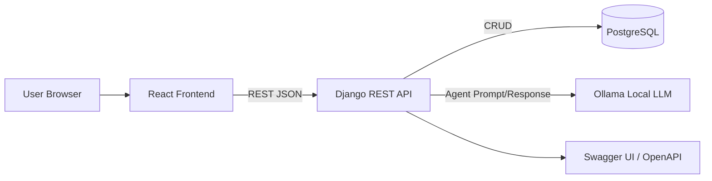

# Quickstart Validation Guide: SpeciaelFamily

## Purpose

Validate end-to-end behavior of the SpeciaelFamily feature stack (React UI, Django REST API,
PostgreSQL, Ollama) and confirm contract, test pyramid, and coverage expectations.

## Prerequisites

- Docker and Docker Compose installed
- Node.js 20+ and Python 3.12+ available for local test tooling (optional if everything runs in containers)
- Ollama model available locally (for example, `llama3.1`)

## Architecture Overview



## Interface Map

- Frontend -> Backend: REST over HTTP JSON (`/api/v1/...`)
- Backend -> Database: PostgreSQL SQL via ORM
- Backend -> Ollama: local inference call interface
- Backend -> Docs: OpenAPI generation + Swagger rendering

## Startup

1. Build and start services:

```bash
docker compose -f infra/docker-compose.yml up --build -d
```

2. Confirm services are healthy:

```bash
docker compose -f infra/docker-compose.yml ps
```

Expected outcome:
- `frontend`, `backend`, `postgres`, and `ollama` show healthy/running state.

## Contract Validation

1. Open Swagger UI endpoint (served by backend).
2. Confirm contract includes task CRUD endpoints and agent session/query endpoints.
3. Verify constraints in docs:
- `title` required and non-empty
- `creator_name` required
- duplicate same-day title handling
- stale task conflict behavior
- agent unavailable error message

Expected outcome:
- OpenAPI and Swagger reflect `specs/001-calendar-task-agent/contracts/openapi.yaml` semantics.

## Functional Validation Scenarios

1. Create task with valid title/date/creator -> expect success.
2. Create task with empty title -> expect validation error.
3. Create duplicate same-day title -> expect conflict error.
4. Delete a task in one tab, then update from another tab -> expect stale conflict message and list refresh behavior.
5. Stop or disconnect Ollama, submit agent question -> expect error message: `Calendar wizard guy is not home at the momen`.
6. Ask ambiguous question without date context -> expect clarification prompt when no selected day context exists.

## Test Pyramid Execution

Backend:

```bash
cd backend
pytest tests/unit
pytest tests/integration
pytest tests/contract
pytest --cov=. --cov-branch --cov-report=xml --cov-report=term
```

Frontend:

```bash
cd frontend
npm test -- --runInBand
npm run test:component
npx playwright test
npm run coverage
```

Expected outcome:
- Unit, component, integration, and E2E tests pass.
- Coverage reports include both line and branch coverage.

## Manual CI Pipeline Validation

1. Trigger `.github/workflows/ci-manual.yml` via `workflow_dispatch`.
2. Verify pipeline stages:
- lint/type checks
- contract validation
- backend tests + coverage
- frontend tests + coverage
- Playwright E2E
3. Verify artifacts published: test reports, coverage summaries, and OpenAPI snapshot.

Expected outcome:
- Pipeline completes successfully when manually triggered.

## Code Quality Suggestions

- Enforce pre-commit hooks for format, lint, and import hygiene.
- Add strict CI thresholds for branch and line coverage by module.
- Use API contract diff checks to guard backward compatibility.
- Add architectural decision records (ADRs) for major interface changes.
- Track flaky tests and gate merges on flake budget.
