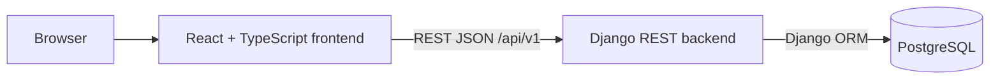

# Quickstart Validation Guide: Simple Home Calendar MVP

## Purpose

Set up the app locally, run each part's tests, and validate the MVP behavior end to end.
Contract details: `specs/001-calendar-task-agent/contracts/openapi.yaml`. Entity and validation
rules: `specs/001-calendar-task-agent/data-model.md`.

## Prerequisites

- Python 3.12+
- Node.js 20+
- PostgreSQL (local install, or via `docker compose -f infra/docker-compose.yml up -d postgres`)

## Architecture Overview



The frontend only talks to the backend REST API and never to the database.

## Setup

Backend (from `backend/`):

```bash
python -m venv .venv && source .venv/bin/activate
pip install -e ".[dev]"
python manage.py migrate
python manage.py runserver 0.0.0.0:8000
```

Frontend (from `frontend/`):

```bash
npm install
cp .env.example .env   # sets VITE_API_BASE_URL, e.g. http://localhost:8000/api/v1
npm run dev -- --host 0.0.0.0
```

Expected outcome:
- `GET http://localhost:8000/api/v1/health` returns `{"status": "ok"}`.
- The calendar UI opens in a browser on the local network.

## Functional Validation Scenarios

1. Open the app; the selected day shows its events or a clear empty state.
2. Create a timed event (title, start, end) -> it appears in the day list without a page refresh.
3. Create an all-day event -> start/end inputs are hidden and it is listed above timed events.
4. Save an event with an empty title -> blocked with the message `Title is required.`
5. Save a timed event with end not after start -> blocked with a clear validation message.
6. Create two events with the same title on the same day -> both are saved.
7. Create two timed events with the same start time -> they appear in creation order.
8. Edit an event (title, time settings, notes) -> updated values are shown.
9. Delete an event -> it disappears from the list.
10. Refresh the page and restart the backend -> all saved events are still present.
11. Navigate to another date -> only that date's events are shown.

## Testing Each Part

Backend (from `backend/`):

```bash
pytest tests/unit          # models, validation, ordering rules
pytest tests/integration   # API flows against PostgreSQL
pytest tests/contract      # responses match the OpenAPI contract
coverage run -m pytest && coverage report
```

Frontend (from `frontend/`):

```bash
npm run test:component     # component and unit tests (Vitest + React Testing Library)
npm run coverage
```

Expected outcome: all suites pass and coverage reports are produced.

## Code Quality Checks

Backend (from `backend/`):

```bash
ruff check . && ruff format --check .
mypy .
```

Frontend (from `frontend/`):

```bash
npm run lint
npm run format:check
npx tsc --noEmit
```

Expected outcome: no lint, format, or type errors. These checks are required before merge.

Note: Ruff, mypy, ESLint, Prettier, and React Router are part of the target toolchain and are
added to the project during implementation (see `tasks.md`).
